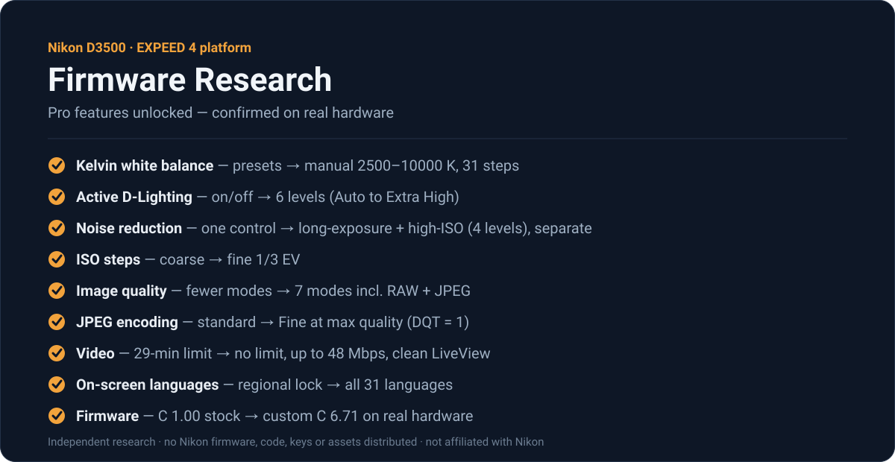

<!-- Idioma: Español · English (primary): README.md -->

[English](README.md) · **Español**

# D3500 EXPEED 4 — Investigación de Firmware

Investigación independiente de ingeniería inversa sobre la **Nikon D3500**
(plataforma EXPEED 4). Documenta capacidades profesionales que los cuerpos EXPEED 4
hermanos (D5600 / D7200) sí exponen, pero que los menús de fábrica de la D3500
mantienen ocultas — y las demuestra **funcionando en hardware real de D3500**.

> [!NOTE]
> **Hecho con IA.** Este es un proyecto asistido por IA: buena parte de la ingeniería
> inversa, las herramientas y estos textos se hicieron con Claude. Lo mío — poseo y opero
> la cámara, dirigí el trabajo, flasheé el firmware y verifiqué cada función en hardware
> real (las fotos son mías).

> [!IMPORTANT]
> **Este repositorio contiene únicamente mi investigación original, metodología,
> mediciones y fotografías.** **No** contiene, distribuye ni enlaza
> ningún firmware, código, clave de descifrado, string extraído, mapa de memoria o
> recurso gráfico de Nikon. Nada aquí permite reproducir el firmware de Nikon.
> Ver [DISCLAIMER.md](DISCLAIMER.md).

---

## Qué demuestra (verificado en hardware)

Cada punto fue fotografiado funcionando en una D3500 física. Ver
[FEATURES.md](docs/FEATURES.md) y [EVIDENCE.md](docs/EVIDENCE.md).

> 📹 **Video demo:** [`media/demo.mp4`](media/demo.mp4) — recorrido completo en hardware real.

- **Balance de blancos Kelvin manual** — selector de temperatura de color con pasos
  finos, en foto y en el menú rápido de video.
- **D-Lighting activo de 6 niveles** (Auto / Extra alto / Alto / Normal / Bajo / Off).
- **Reducción de ruido desacoplada** — RR exposición prolongada y RR ISO alta como
  controles independientes.
- **Calidad de imagen de 7 modos**, incluidas las combinaciones RAW + JPEG que el
  cuerpo de fábrica omite.
- **ISO en pasos de 1/3 EV** en el rango nativo.
- **Conjunto de idiomas en pantalla ampliado.**
- Un **firmware personalizado** que arranca y opera con normalidad (visible en
  *Versión del firmware*).

## Qué **no** hace

Honestidad primero — no reclama hardware que la D3500 no tiene:

- Sin focus peaking, sin motor AF en cuerpo, sin Wi-Fi interno, sin mando IR, sin
  pantalla abatible/táctil, sin entrada de micrófono estéreo: **ausentes físicamente**.
- Solo NEF (RAW) es sin pérdidas; JPEG sigue siendo con pérdidas.
- Son **capacidades EXPEED 4 portadas de cuerpos hermanos**, no hardware nuevo.

## Por qué es legal y seguro de publicar

Es ingeniería inversa de una cámara que **poseo**, con fines de investigación e
interoperabilidad. Siguiendo el modelo histórico de la comunidad (p. ej. Nikon-Hacker),
aquí publico **solo conocimiento y evidencia propia** — nunca firmware, claves ni
recursos de Nikon. Este proyecto es **no comercial** y **no está afiliado ni respaldado
por Nikon Corporation**. «Nikon», «D3500» y «EXPEED» son marcas de su titular, usadas
aquí solo de forma descriptiva.

## Contenido

| Ruta | Qué contiene |
|---|---|
| [docs/FEATURES.md](docs/FEATURES.md) | Capacidades de fábrica vs. investigadas, con sus límites (en inglés) |
| [docs/EVIDENCE.md](docs/EVIDENCE.md) | Capturas en hardware y mis mediciones (en inglés) |
| [docs/METHODOLOGY.md](docs/METHODOLOGY.md) | Método a alto nivel, sin internos del firmware (en inglés) |
| [DISCLAIMER.md](DISCLAIMER.md) | Aviso legal, no afiliación, sin garantía (bilingüe) |
| [media/](media/) | Mis fotografías y capturas (numeradas en el orden de la evidencia) + video demo |

## Contacto / colaboración

Investigación independiente de **Luis Vergara Arrieta** (Chile). Sin afiliación con Nikon.
Talleres de reparación, fabricantes de accesorios e investigadores interesados en la
interoperabilidad EXPEED 4 pueden escribir:

- LinkedIn: https://www.linkedin.com/in/luis-vergara-arrieta-0116a2323/

## Licencia

Documentación y medios: **CC BY 4.0**. Código que se agregue: **MIT**. Ver [LICENSE](LICENSE).
