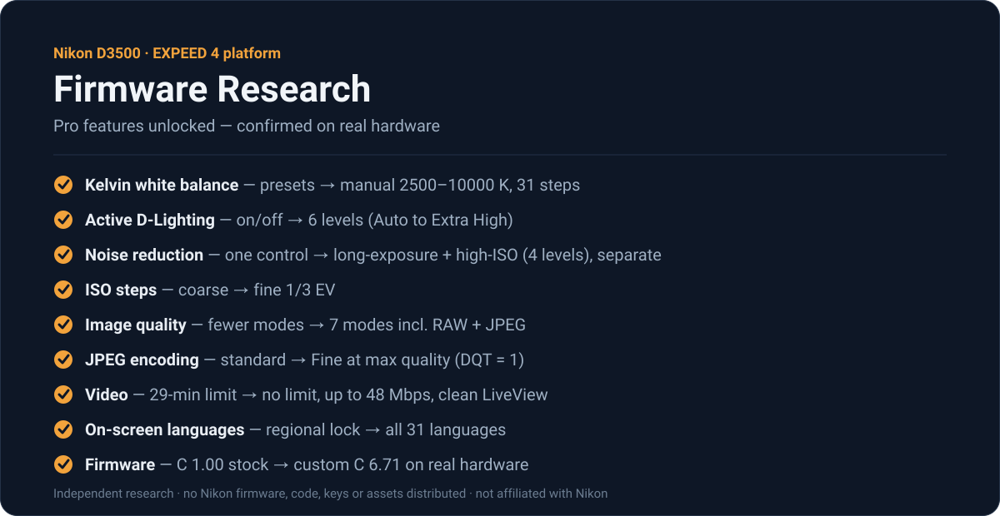

<!-- Idioma: English (primary) · Español: README.es.md -->

**English** · [Español](README.es.md)

# D3500 EXPEED 4 — Firmware Research

Independent reverse-engineering research on the **Nikon D3500** (EXPEED 4 platform).
This project documents professional capabilities that the D3500's sibling EXPEED 4
bodies (D5600 / D7200) expose, but that the D3500's stock menus keep hidden — and
demonstrates them **operating on real D3500 hardware**.

> [!NOTE]
> **Built with AI.** This is an AI-assisted project: much of the reverse-engineering
> analysis, the tooling, and these writeups were done with Claude. What's mine — I own and
> operate the camera, I directed the work, I flashed the firmware, and I verified every
> feature on real hardware (the photos here are mine).

> [!IMPORTANT]
> **This repository contains only my own original research, methodology, measurements,
> and photographs.** It does **not** contain, distribute, or link to
> any Nikon firmware, source code, decryption keys, extracted strings, memory maps, or
> graphic assets. Nothing here lets a reader reproduce Nikon's firmware. See
> [DISCLAIMER.md](DISCLAIMER.md).

---

## What this demonstrates (verified on hardware)

Each item below was photographed running on a physical D3500. See
[FEATURES.md](docs/FEATURES.md) for the honest comparison table and
[EVIDENCE.md](docs/EVIDENCE.md) for the captures.

> 📹 **Demo video:** [`media/demo.mp4`](media/demo.mp4) — full walkthrough on real hardware.

- **Manual Kelvin white balance** — a working color-temperature selector with fine
  steps, in both stills and the movie quick menu.
- **Active D-Lighting with 6 levels** (Auto / Extra High / High / Normal / Low / Off),
  up from the stock on/off.
- **Decoupled noise reduction** — Long-Exposure NR and High-ISO NR as two independent
  controls.
- **Image Quality with 7 modes**, including the RAW + JPEG combinations the stock body
  omits.
- **ISO in 1/3-EV steps** across the native range.
- **Expanded on-screen language set.**
- A **custom firmware build** that boots and operates normally (shown under
  *Firmware Version* in-camera).

## What it does **not** do

Honesty first — this project does not claim hardware the D3500 lacks:

- No focus peaking, no in-body AF motor, no built-in Wi-Fi, no IR remote, no tilt/touch
  screen, no stereo-mic jack — these are **physically absent** and software cannot add them.
- Only NEF (RAW) is lossless; JPEG remains a lossy format.
- These are **EXPEED 4 capabilities ported from sibling bodies**, not new hardware features.

## Why this is lawful and safe to publish

This is reverse-engineering of a camera **I own**, for research and interoperability.
Following the long-standing camera-RE community model (e.g. Nikon-Hacker), I publish
**only knowledge and my own evidence** here — never Nikon's copyrighted firmware, keys,
or assets. This project is **non-commercial** and **not affiliated with, endorsed by, or
connected to Nikon Corporation**. "Nikon", "D3500" and "EXPEED" are trademarks of their
owner, used here only descriptively.

## Contents

| Path | What's in it |
|---|---|
| [docs/FEATURES.md](docs/FEATURES.md) | Stock vs. researched capabilities, with honest limits |
| [docs/EVIDENCE.md](docs/EVIDENCE.md) | Hardware captures and my own measurements |
| [docs/METHODOLOGY.md](docs/METHODOLOGY.md) | High-level method (no firmware internals) |
| [DISCLAIMER.md](DISCLAIMER.md) | Legal notice, non-affiliation, no-warranty |
| [media/](media/) | My own photographs and screen captures (numbered in evidence order) + demo video |

## About / collaboration

Independent research by **Luis Vergara Arrieta** (Chile). Not affiliated with Nikon.
Repair shops, accessory makers, and researchers interested in EXPEED 4
interoperability are welcome to get in touch:

- LinkedIn: https://www.linkedin.com/in/luis-vergara-arrieta-0116a2323/

## License

Documentation and media: **CC BY 4.0**. Any code added later: **MIT**.
See [LICENSE](LICENSE).
