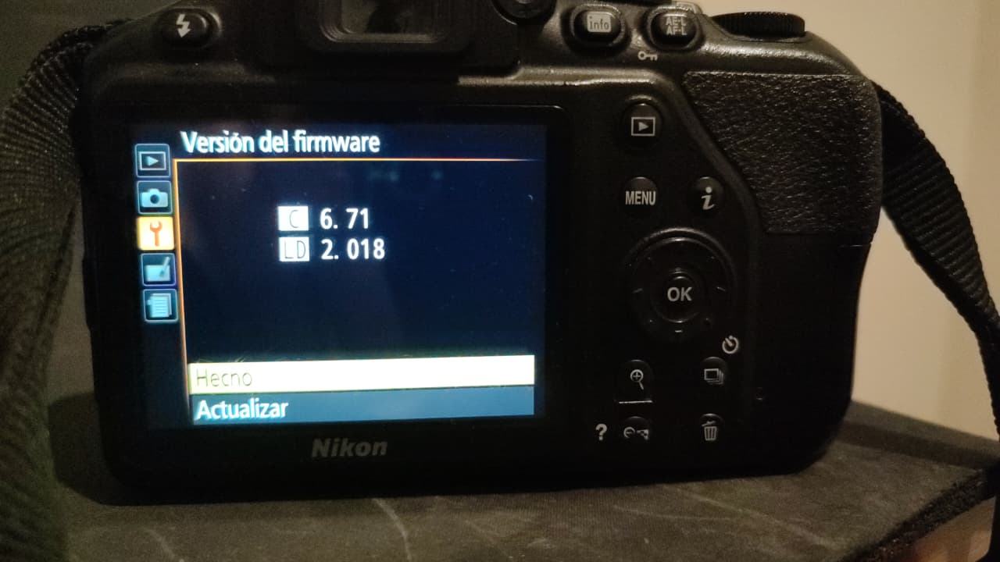
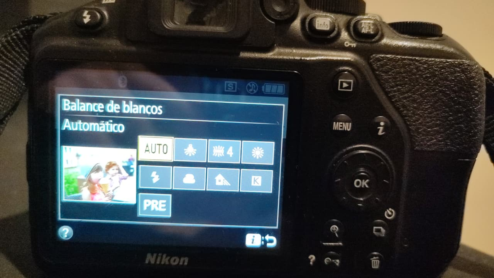
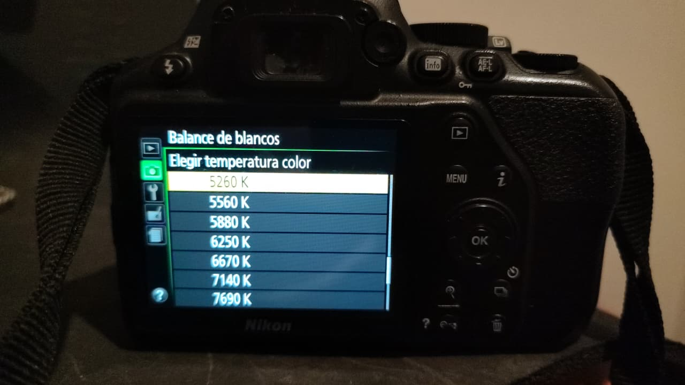
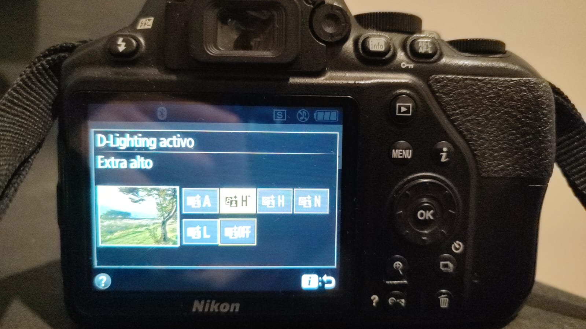
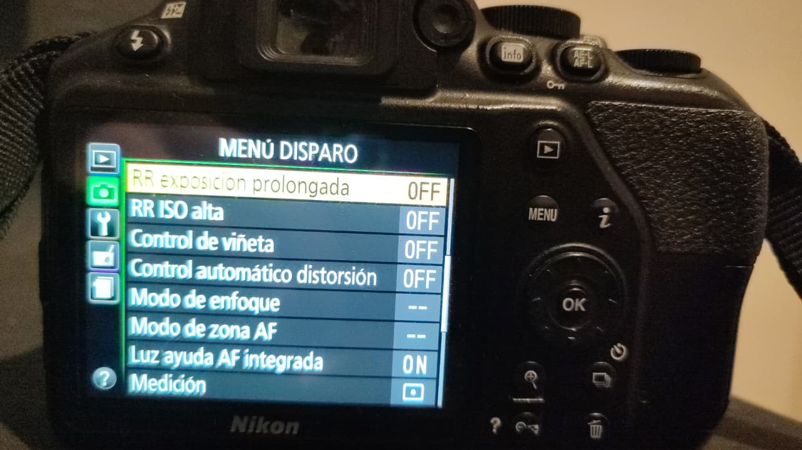
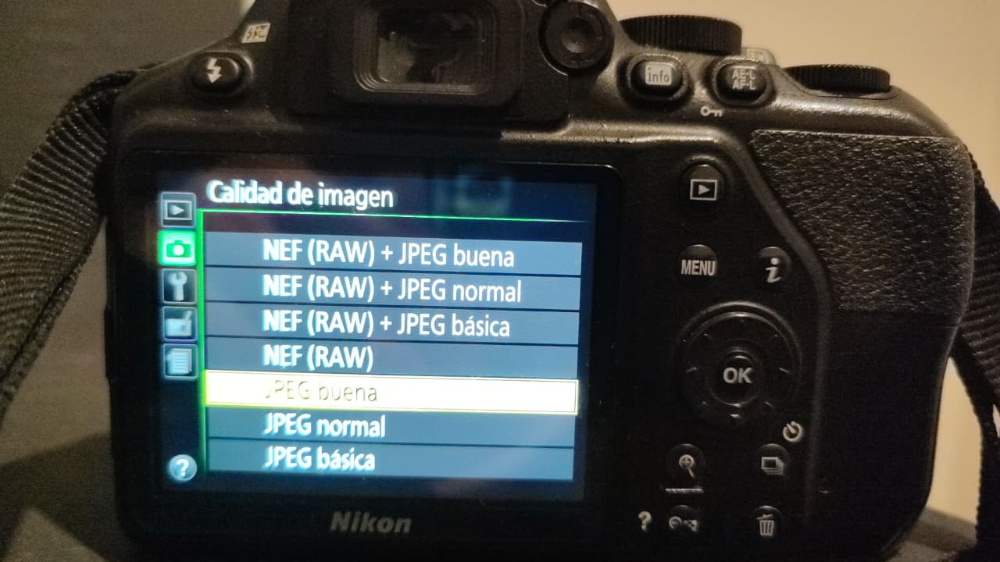
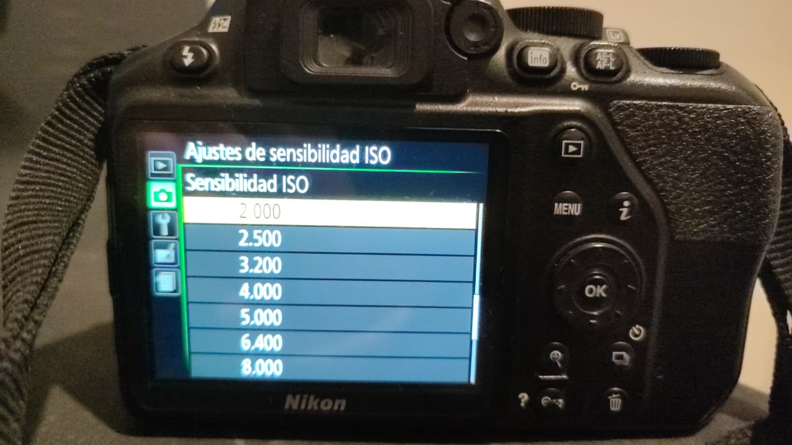
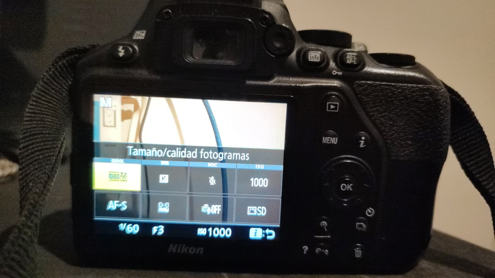
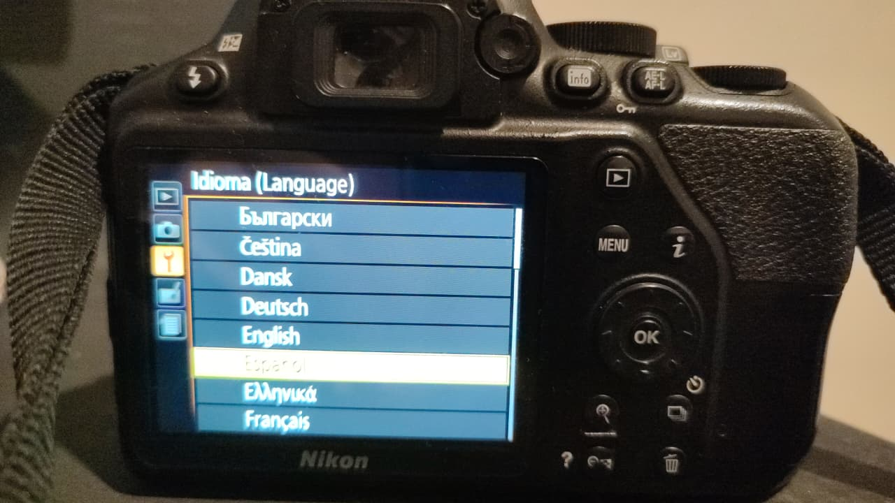

# Evidence

All media here is **my own** — photographs of a physical Nikon D3500 screen and a demo
video. No Nikon assets are reproduced.

> 📹 **Full walkthrough:** [`media/demo.mp4`](../media/demo.mp4).

## 1. Custom firmware running

The *Firmware Version* screen shows the custom build (**C 6.71 / LD 2.018**), confirming
it boots and operates on real hardware. Nikon never shipped a body-firmware update for
the D3500 — so a non-stock version here is, by itself, proof of the work.

## 2. Kelvin white balance — available in the WB menu

The white-balance menu now exposes the **K** (color-temperature) option alongside the
stock presets.

## 3. Kelvin white balance — temperature selector

A working color-temperature selector with fine steps (visible here: **5260–7690 K**).

## 4. Active D-Lighting — 6 levels

Auto / Extra High / High / Normal / Low / Off — up from the stock on/off (Extra High
selected).

## 5. Decoupled noise reduction

*Long-exposure NR* and *high-ISO NR* as two independent items in the shooting menu.

## 6. Image Quality — 7 modes

RAW+JPEG (fine / normal / basic), RAW, and JPEG (fine / normal / basic) — including the
RAW+JPEG combinations the stock body omits.

## 7. ISO in 1/3-EV steps

Fine 1/3-EV granularity (visible here: 2000 · 2500 · 3200 · 4000 · 5000 · 6400 · 8000).

## 8. Movie quick menu — Kelvin WB in video

The movie *frame size/quality* quick menu showing the **K** white-balance option and
1080/60.

## 9. Expanded languages

A scrolling multi-language list.
